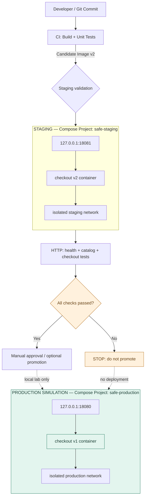
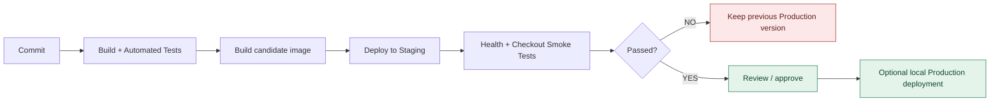

# 02 — Staging Environment: قبل از Production، نسخه جدید را واقعی تست کن 🧪

**پروژه:** [Safe Deployment From Zero](../README.md) · **مجموعه آموزشی:** NetworksComputing / Sananet  
**پیش‌نیاز پیشنهادی:** [مرحله اول: CI/CD Pipeline](../01-ci-cd/)

در مرحله اول، GitLab Pipeline کد را تست کرد و Docker Image ساخت. اما موفقیت تست‌های CI به معنی این نیست که نسخه جدید حتماً در شرایط اجرا هم درست عمل می‌کند. در این مرحله دو محیط **کاملاً مجزا** می‌سازیم، نسخه v2 را فقط به **Staging** می‌بریم، API فروشگاه را واقعاً تست می‌کنیم و عمداً یک Regression در محاسبه خرید ایجاد می‌کنیم تا ببینیم چرا نسخه مشکوک نباید وارد Production شود.

> ⚠️ **دقت:** منظور از `Production` در این لابراتوار، یک **Production Simulation روی کامپیوتر خودتان** است؛ نه سرور واقعی، نه سرویس عمومی و نه محیط آماده بهره‌برداری تجاری. هیچ پرداخت واقعی انجام نمی‌شود.

## قرار است چه چیزی یاد بگیریم؟

- **Staging Environment** چیست و چرا از Production جدا می‌شود؟
- چطور با **Docker Compose Projectهای جداگانه**، شبکه و کانتینر مستقل داشته باشیم؟
- چطور یک نسخه تازه با تغییر واقعی کد را وارد Staging کنیم، بدون تغییر Production آزمایشی؟
- چرا `HTTP 200` از `/health` به‌تنهایی کافی نیست و باید **سناریوی واقعی Checkout** را تست کرد؟
- چطور در صورت شکست تست، **انتشار را متوقف** کنیم و نسخه سالم قبلی همچنان در دسترس بماند؟

## نمودار ۱ — معماری دو محیط مستقل

> نمودارهای Mermaid در GitHub و GitLab پشتیبانی می‌شوند. اگر پیش‌نمایش Markdown شما Mermaid را نشان نمی‌دهد، متن و دستورهای زیر همچنان قابل استفاده‌اند.



**نکته معماری:** دو محیط Compose project جدا، container جدا، network جدا، پورت جدا و image tag مجزا دارند. در این دمو داده پایداری نداریم؛ در سیستم واقعی دیتابیس، secrets، DNS، صف‌ها، اکانت سرویس‌ها و مجوزها هم باید جدا یا با سیاست دسترسی محدود و امن تنظیم شوند. صرف استفاده از Docker Compose معادل isolation امنیتی کامل نیست.

## نمودار ۲ — چرخه انتشار پیشنهادی



**نکته:** این لابراتوار **دستی و آموزشی** است؛ فایل CI/CD مرحله اول را تغییر نمی‌دهد و ادعا نمی‌کند که این گردش کار به‌طور خودکار به GitLab متصل شده است. در ادامه می‌توان Jobs مربوط به Staging و Approval را به Pipeline اضافه کرد.

---

## ساختار فایل‌های بخش دوم

```text
safe-deployment-from-zero/
├── demo-app/                            # سورس مشترک فروشگاه؛ Dockerfile و تست‌ها
│   ├── Dockerfile
│   ├── app/{server,catalog,checkout}.py
│   └── scripts/smoke_test.py
└── 02-staging/
    ├── README.md                        # همین راهنمای مرحله‌به‌مرحله + نمودارها
    ├── compose.production.yml            # شبیه‌ساز Production روی localhost:18080
    ├── compose.staging.yml               # Staging روی localhost:18081
    ├── .gitignore                        # عدم انتشار خروجی‌های موقت Build
    └── scripts/
        ├── prepare_candidate.py          # تولید سورس نسخه v2 سالم/خراب، بدون ویرایش demo-app
        ├── validate_environment.py       # تست HTTP، کاتالوگ و مبلغ واقعی خرید
        └── verify_isolation.py           # تأیید خرابی Staging و سلامت Production
```

### چرا همان `demo-app/` قبلی را استفاده می‌کنیم؟

همان فروشگاه ساده مرحله اول را داریم:

| Endpoint | کاربرد | انتظار تست |
|---|---|---|
| `GET /health` | بررسی پاسخ‌گویی سرویس و شناسه نسخه | `200` و `status=ok` |
| `GET /api/products` | دریافت کاتالوگ | وجود محصولات موردانتظار |
| `POST /api/checkout` | محاسبه سفارش واقعی شبیه‌سازی‌شده | محاسبه دقیق تعداد، جمع و ارسال |

یک تغییر کوچک و **سازگار با مرحله اول** اضافه شده: پاسخ `/health` اکنون مقدار `APP_VERSION` را از Environment می‌خواند و اگر تنظیم نشده باشد، همان `v1` قبلی است. این متغیر فقط برای نمایش نسخه در لابراتوار استفاده می‌شود؛ **نسخه واقعی کد را Image تعیین می‌کند، نه تغییر نام این متغیر**.

## پیش‌نیازها

- Docker Engine یا Docker Desktop، به همراه **Docker Compose v2** (`docker compose`)
- Python 3.12 یا جدیدتر برای تولید Candidate و اجرای تست‌ها (فقط Standard Library)
- امکان اجرای دستورات از Terminal
- پورت‌های محلی **18080** و **18081** آزاد باشند

تمام دستورهای زیر را **از ریشه ریپازیتوری** (`safe-deployment-from-zero/`) اجرا کنید. اگر Docker روی سیستمتان در دسترس نیست، می‌توانید اسکریپت‌ها و کدها را بخوانید یا تست‌های Python را انجام دهید؛ اجرای واقعی Compose نیازمند Docker است.

---

## قدم ۱ — نسخه سالم v1 را بساز و فقط در Production آزمایشی اجرا کن

ابتدا Image قدیمی فروشگاه را از سورس مشترک Build کن:

```bash
docker build -t safe-demo:stable demo-app
```

محیط Production آزمایشی را راه‌اندازی کن:

```bash
docker compose -p safe-production -f 02-staging/compose.production.yml up -d
```

حالا رفتار واقعی محیط را بررسی کن:

```bash
curl -s http://127.0.0.1:18080/health
python3 02-staging/scripts/validate_environment.py \
  --url http://127.0.0.1:18080 --version v1 --catalog stable
```

باید چهار تأیید ببینی: سرویس سالم است، کاتالوگ v1 درست است، Checkout درست حساب می‌کند و سفارش نامعتبر رد می‌شود. همین نسخه v1 را در تمام آزمایش‌های بعدی روشن نگه می‌داریم.

**چرا `-p safe-production`؟** این گزینه برای Compose یک نام پروژه ثابت می‌سازد؛ کانتینرها و شبکه این محیط با محیط Staging مشترک نمی‌شوند. پورت روی `127.0.0.1` Publish می‌شود تا در این لابراتوار به‌صورت پیش‌فرض از شبکه بیرونی سیستم قابل دسترس نباشد.

## قدم ۲ — از همان اپلیکیشن، نسخه v2 با تغییر واقعی بساز

در نسخه v2 یک محصول جدید به فروشگاه اضافه می‌کنیم:

| Version | کاتالوگ |
|---|---|
| v1 | keyboard, mouse, pad |
| v2 | keyboard, mouse, pad, **webcam** |

برای حفظ یکپارچگی دوره اول، سورس `demo-app/` را دستی ویرایش نمی‌کنیم. اسکریپت زیر یک **کپی مجزا برای Candidate** می‌سازد و فقط کاتالوگ آن را تغییر می‌دهد:

```bash
python3 02-staging/scripts/prepare_candidate.py --variant good
```

خروجی در مسیر **نادیده‌گرفته‌شده توسط Git** قرار می‌گیرد: `02-staging/.build/candidate-good/`.

حالا Image مخصوص Staging را بساز:

```bash
docker build -t safe-demo:candidate-good 02-staging/.build/candidate-good
```

**نکته:** Tagهای `stable` و `candidate-good` دو Image متمایزند. در Production واقعی بهتر است نسخه‌ها با **Commit SHA یا Image Digest تغییرناپذیر** شناخته شوند؛ Tagهای این آزمایش صرفاً برای خوانایی‌اند.

## قدم ۳ — Staging را جدا از Production بالا بیاور

```bash
docker compose -p safe-staging -f 02-staging/compose.staging.yml up -d
```

حالا دو URL محلی داریم:

| محیط | URL | Image | نسخه نمایشی |
|---|---|---|---|
| Production Simulation | `http://127.0.0.1:18080` | `safe-demo:stable` | v1 |
| Staging | `http://127.0.0.1:18081` | `safe-demo:candidate-good` | v2 |

```bash
curl -s http://127.0.0.1:18080/health
curl -s http://127.0.0.1:18081/health

docker compose -p safe-production -f 02-staging/compose.production.yml ps
docker compose -p safe-staging -f 02-staging/compose.staging.yml ps
```

شبکه‌های جدا را ببین:

```bash
docker network ls --filter label=com.docker.compose.project=safe-production
docker network ls --filter label=com.docker.compose.project=safe-staging
```

### نکته خیلی مهم در مورد دیتابیس

اینجا هیچ Database یا Volume دائمی وجود ندارد. در پروژه واقعی Staging را به دیتابیس اصلی و اطلاعات حساس کاربران متصل نکن؛ از داده ساختگی یا داده ناشناس‌سازی‌شده و مجوزهای کمینه استفاده کن. شباهت تنظیمات Staging به Production مهم است، اما **نباید به قیمت دسترسی ناامن به داده و سرویس واقعی تمام شود**.

## قدم ۴ — تست رفتار واقعی Staging (نه فقط Health Check)

ابتدا مستقیم API را بررسی کن:

```bash
curl -s http://127.0.0.1:18081/api/products
curl -s -X POST http://127.0.0.1:18081/api/checkout \
  -H 'Content-Type: application/json' \
  -d '{"items":[{"sku":"keyboard","quantity":2},{"sku":"mouse","quantity":1}]}'
```

قیمت‌های مثال: `keyboard = 4500 cents` و `mouse = 2500 cents`.

| محاسبه | انتظار |
|---|---|
| `2 × keyboard` | 9000 |
| `1 × mouse` | 2500 |
| **Subtotal** | **11500** |
| Shipping (خرید بالای 10000) | 0 |
| **Total** | **11500** |

حالا تست خودکار Staging را اجرا کن:

```bash
python3 02-staging/scripts/validate_environment.py \
  --url http://127.0.0.1:18081 --version v2 --catalog candidate
```

انتظار:

```text
PASS http://127.0.0.1:18081: HTTP healthy; release=v2
PASS http://127.0.0.1:18081: catalog type=candidate
PASS http://127.0.0.1:18081: checkout amounts correct
PASS http://127.0.0.1:18081: invalid order rejected
ENVIRONMENT VALIDATION: ALL PASSED
```

تست Smoke اصلی مرحله اول هم روی Staging قابل استفاده است:

```bash
python3 demo-app/scripts/smoke_test.py http://127.0.0.1:18081
```

**چرا این تست ارزش دارد؟** چون ممکن است اپلیکیشن بالا باشد، `/health` جواب `200` بدهد و حتی لیست محصولات نمایش داده شود، ولی **مبلغ سفارش اشتباه محاسبه شود**. تست Checkout این نوع Regression را تشخیص می‌دهد.

---

## قدم ۵ — یک باگ واقعی بساز و فقط روی Staging منتشر کن

حالا بخش اصلی آزمایش! نسخه `broken` را می‌سازیم که در محاسبه Subtotal **تعداد کالا را نادیده می‌گیرد**.

فقط داخل Candidate ساخته‌شده، این خط:

```python
subtotal_cents += line_total_cents
```

به این خط اشتباه تبدیل می‌شود:

```python
subtotal_cents += unit_price_cents  # LAB BUG: ignores quantity
```

سورس پایه `demo-app/` سالم باقی می‌ماند و Image مربوط به Production تغییر نمی‌کند:

```bash
python3 02-staging/scripts/prepare_candidate.py --variant broken
docker build -t safe-demo:candidate-broken 02-staging/.build/candidate-broken
```

فقط سرویس **Staging** را به Image خراب تغییر بده (در ترمینال Bash / Zsh):

```bash
STAGING_IMAGE=safe-demo:candidate-broken \
  docker compose -p safe-staging -f 02-staging/compose.staging.yml up -d --force-recreate
```

> این دستور عمداً فقط روی `safe-staging` اثر دارد. `safe-production` هیچ‌وقت با Image خراب آپدیت نمی‌شود.

### حالا تفاوت Health Check و Business Test را ببین

```bash
curl -s http://127.0.0.1:18081/health
```

هنوز `status=ok` و `version=v2` است! اما:

```bash
python3 02-staging/scripts/validate_environment.py \
  --url http://127.0.0.1:18081 --version v2 --catalog candidate
```

**باید شکست بخورد (Exit Code = 1)** و پیام `Checkout mismatch` بدهد. چون برای سفارش دو کیبورد و یک موس، نسخه خراب جمع را **7000** سنت حساب می‌کند، نه **11500** سنت. این دقیقاً همان خطایی است که در فروشگاه واقعی می‌تواند به ضرر کسب‌وکار تمام شود.

### بررسی کنیم Production واقعاً دست‌نخورده مانده

```bash
python3 02-staging/scripts/verify_isolation.py
```

خروجی موردانتظار:

```text
PASS http://127.0.0.1:18080: HTTP healthy; release=v1
PASS http://127.0.0.1:18080: catalog type=stable
PASS http://127.0.0.1:18080: checkout amounts correct
PASS http://127.0.0.1:18080: invalid order rejected
ENVIRONMENT VALIDATION: ALL PASSED
EXPECTED REGRESSION DETECTED: staging checkout subtotal = 7000
PASS: local production remained healthy, unchanged and isolated
```

**یادگیری کلیدی:** تست Staging شکست می‌خورد، پس **نباید Candidate را Promote کنیم**. همین جداسازی باعث شده باگ آزمایشی، Production شبیه‌سازی‌شده را خراب نکند.

## قدم ۶ — نسخه سالم را دوباره روی Staging اجرا کن

```bash
STAGING_IMAGE=safe-demo:candidate-good \
  docker compose -p safe-staging -f 02-staging/compose.staging.yml up -d --force-recreate

python3 02-staging/scripts/validate_environment.py \
  --url http://127.0.0.1:18081 --version v2 --catalog candidate
```

اگر تست‌ها سبز شدند، نسخه **در این لابراتوار** برای تصمیم‌گیری درباره انتشار آماده است. موفقیت تست Staging **تضمین** نمی‌کند که هیچ مشکلی در محیط واقعی به وجود نمی‌آید.

## قدم ۷ — اختیاری: Promotion دستی به Production شبیه‌سازی‌شده

فقط بعد از پاس‌شدن تست Staging، در صورت تمایل نسخه v2 سالم را روی **Production محلی** منتشر کن. این تمرین **یک Deploy دستی است، نه Canary، نه Zero-Downtime و نه Pipeline خودکار**:

```bash
PRODUCTION_IMAGE=safe-demo:candidate-good PRODUCTION_VERSION=v2 \
  docker compose -p safe-production -f 02-staging/compose.production.yml up -d --force-recreate

python3 02-staging/scripts/validate_environment.py \
  --url http://127.0.0.1:18080 --version v2 --catalog candidate
```

اگر مرحله اختیاری را انجام دادی، برای برگشت به حالت اولیه آزمایش:

```bash
docker compose -p safe-production -f 02-staging/compose.production.yml up -d --force-recreate
```

در **مرحله سوم** همین ریپازیتوری، به سراغ **Canary Deployment** می‌رویم تا به‌جای جایگزینی یک‌باره نسخه، ترافیک را با NGINX به‌شکل تدریجی بین دو نسخه تقسیم کنیم.

## قدم ۸ — پاک‌سازی

```bash
docker compose -p safe-staging -f 02-staging/compose.staging.yml down
docker compose -p safe-production -f 02-staging/compose.production.yml down
```

این دستورات فقط دو Compose Project همین لابراتوار را متوقف و حذف می‌کنند؛ Imageها را پاک نمی‌کنند. برای پاک‌کردن Imageهای آموزشی در صورت نیاز:

```bash
docker image rm safe-demo:stable safe-demo:candidate-good safe-demo:candidate-broken
```

پوشه `02-staging/.build/` موقتی است و داخل ZIP گنجانده نشده؛ با اجرای اسکریپت‌ها دوباره ساخته می‌شود.

---

## تفاوت CI، Staging و Production چیست؟

| مفهوم | چه چیزی بررسی می‌کند؟ | چه چیزی را تضمین نمی‌کند؟ |
|---|---|---|
| **CI** | صحت منطق کد، تست‌ها و قابلیت Build | سازگاری با همه شرایط اجرا |
| **Staging** | رفتار نسخه جدید در محیط جدا و تا حد ممکن مشابه Production | یکسان بودن ۱۰۰٪ بار، ترافیک و داده واقعی |
| **Production** | سرویس‌دهی به کاربران واقعی | این‌که نسخه جدید بدون ریسک است |

### سؤالات متداول

**اگر CI تست کرده، چرا Staging لازم داریم؟** تست‌های CI معمولاً روی کد یا کانتینر موقت اجرا می‌شوند. Staging فرصت آزمایش کانفیگ، اتصال‌ها، رفتار End-to-End و Integration قبل از دست‌زدن به Production را می‌دهد.

**اگر Health Check سبز است، می‌توانیم Deploy کنیم؟** نه لزوماً. Health Check ساده فقط نشان می‌دهد سرویس پاسخ می‌دهد. در این مثال، نسخه خراب Health Check سالم دارد اما مبلغ Checkout را اشتباه محاسبه می‌کند؛ بنابراین Business Smoke Test و معیارهای مرتبط هم مهم‌اند.

**آیا هر پروژه باید Staging کاملاً مشابه Production داشته باشد؟** هدف، **شباهت کافی برای کشف ریسک‌های مهم** است. مقیاس و هزینه ممکن است متفاوت باشد، ولی نسخه نرم‌افزار، نوع سرویس‌های وابسته و تنظیمات مهم باید تا حد امکان نماینده شرایط واقعی باشند.

**آیا از Docker Compose برای Production واقعی هم استفاده می‌کنیم؟** ممکن است برای برخی سیستم‌های ساده مناسب باشد، ولی این فایل‌ها **عمداً برای آزمایش محلی** نوشته شده‌اند. در زیرساخت واقعی به امنیت، دسترسی‌ها، داده، پایش، پشتیبان‌گیری، ظرفیت و استراتژی انتشار مناسب نیاز داریم.

### عیب‌یابی

- **`docker: command not found`**: Docker را نصب و اجرا کن؛ صرف داشتن Python کافی نیست.
- **`docker compose` در دسترس نیست**: Docker Compose v2 / Plugin را نصب کن.
- **`port is already allocated`**: پورت‌های پیش‌فرض 18080 و 18081 را خالی کن یا با `PRODUCTION_PORT` و `STAGING_PORT` تغییر بده. اگر پورت‌ها را تغییر دادی، URL اسکریپت‌ها را هم عوض کن. برای `verify_isolation.py` در نمونه فعلی پورت‌های پیش‌فرض لازم‌اند.
- **`No such image`**: قبل از `docker compose up` مراحل `docker build` را اجرا کن. Compose در این بخش عامدانه Image را خودش Build نمی‌کند.
- **تست Staging بعد از ساخت نسخه Broken هنوز سبز است**: مطمئن شو `STAGING_IMAGE=safe-demo:candidate-broken` را **در همان دستور up** قرار دادی و از `--force-recreate` استفاده کردی.
- **Health سالم ولی تست Checkout قرمز است**: این دقیقاً سناریوی موردنظر مرحله ۵ است؛ نسخه خراب را روی Production منتشر نکن.

## ملاحظات Production

این مثال **Secret، Database واقعی، داده مشتری، HTTPS، Network Policy یا مجوزهای سخت‌گیرانه Runtime** را پیاده نمی‌کند. برای سرویس واقعی، دسترسی Staging به Production را حداقلی نگه دار و از Test Data امن استفاده کن. `APP_VERSION` در این آزمایش فقط برچسب نمایشی است و قابل اتکا برای کنترل Supply Chain نیست. به‌علاوه **Rollback اپلیکیشن** لزوماً Migration دیتابیس یا عملیات تجاری انجام‌شده را به عقب برنمی‌گرداند.

### منابع رسمی

- [Docker Compose: Project name](https://docs.docker.com/compose/how-tos/project-name/)
- [Docker Compose networking](https://docs.docker.com/compose/how-tos/networking/)
- [Docker Compose CLI reference](https://docs.docker.com/reference/cli/docker/compose/)
- [GitLab CI/CD documentation](https://docs.gitlab.com/ci/)

---

**مرحله بعدی:** [03 — Canary Deployment با NGINX و Kubernetes](../03-canary/) (در دست تهیه).  
**NetworksComputing / Sananet — Learn DevOps by doing.**
