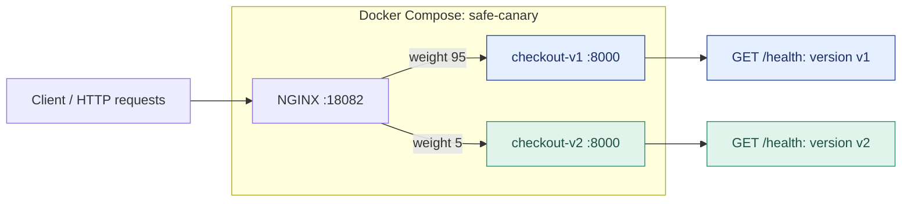
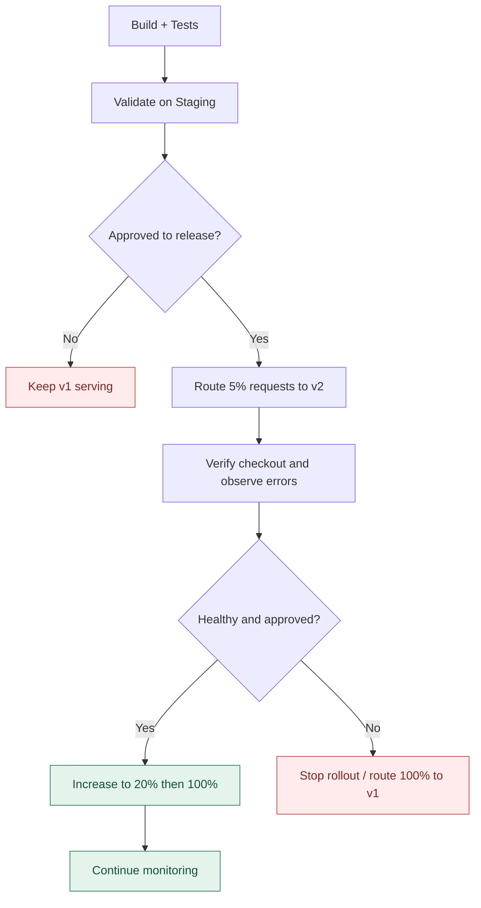
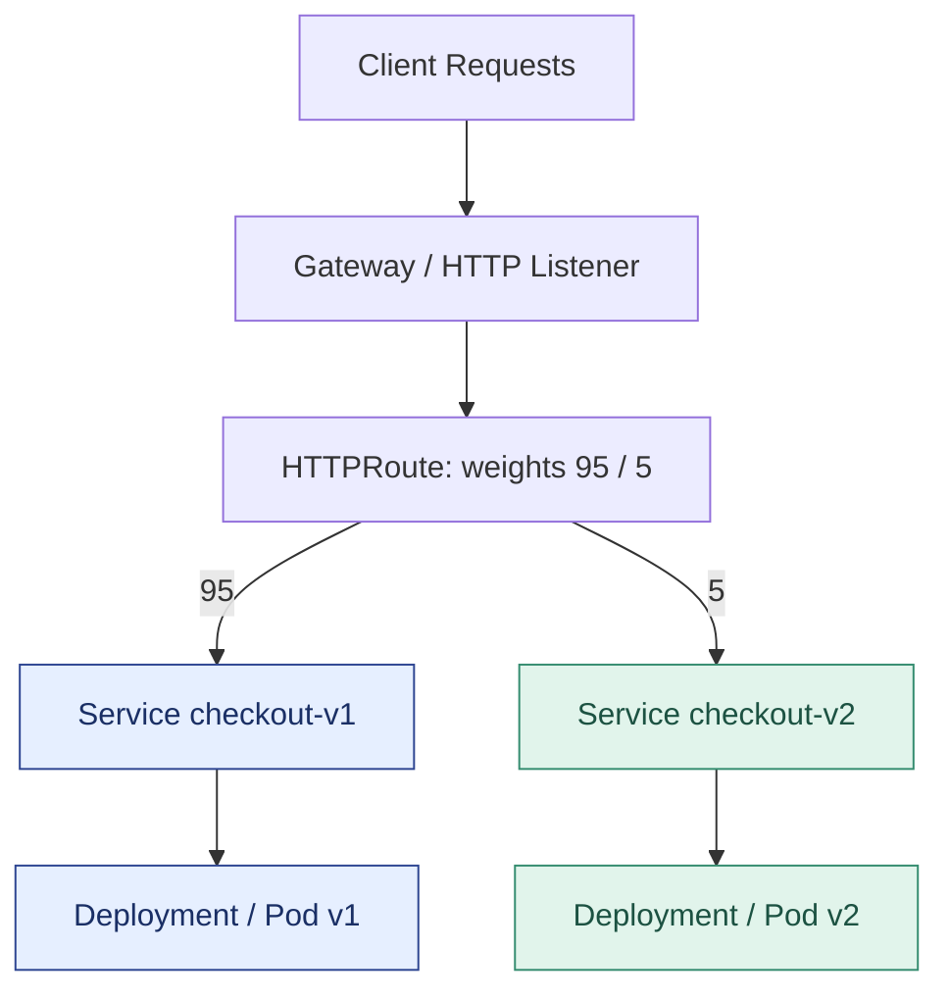

# 03 — Canary Deployment: انتشار تدریجی با NGINX و Kubernetes 🐤

**پروژه:** [Safe Deployment From Zero](../README.md) · **تهیه‌شده برای:** NetworksComputing / Sananet  
**پیش‌نیاز پیشنهادی:** [CI/CD](../01-ci-cd/) و [Staging](../02-staging/)

در دو بخش قبلی، با CI/CD کد فروشگاه را تست کردیم و نسخه جدید را در یک محیط Staging مستقل اجرا کردیم. حالا فرض کن نسخه از Staging عبور کرده، اما می‌خواهیم قبل از فرستادن **تمام ترافیک Production** به آن، رفتارش را در مقیاس کوچک مشاهده کنیم. اینجا **Canary Deployment** به کار می‌آید.

در این لابراتوار دو نسخه از همان اپلیکیشن فروشگاه (`v1` و `v2`) را هم‌زمان اجرا می‌کنیم و به کمک **Weighted Load Balancing** درخواست‌ها را مرحله‌به‌مرحله منتقل می‌کنیم: ابتدا `95/5`، سپس `80/20` و در نهایت `0/100`. در صورت نیاز، می‌توانیم ترافیک را با پروفایل `100/0` به نسخه قبلی برگردانیم. **این فقط تغییر مسیر درخواست‌هاست؛ Rollback کامل برنامه و داده موضوع مرحله چهارم است.**

> ⚠️ **مهم:** تمام تمرین‌های این بخش آموزشی و محلی‌اند. «Production» در نمودارها یک **شبیه‌سازی** است، نه سرویس واقعی. تغییر وزن برای تمام اپلیکیشن‌ها کافی نیست: سازگاری Schema دیتابیس، Session Affinity، تراکنش‌های بلندمدت، WebSocket، ظرفیت و Monitoring در محیط واقعی مهم‌اند.

## قراره چه چیزی یاد بگیری؟

1. تفاوت Rolling Update و **Canary Traffic Splitting** را در عمل ببینی.
2. با **NGINX Open Source** بین دو نسخه ترافیک را با وزن‌های متفاوت توزیع کنی.
3. با یک اسکریپت واقعی HTTP تعداد درخواست‌های رسیده به هر نسخه را اندازه بگیری.
4. درخواست واقعی **Checkout** را از مسیر Load Balancer تست کنی؛ نه فقط `/health`.
5. وزن نسخه جدید را به `20%` و سپس `100%` افزایش دهی یا در صورت مشکل، ترافیک را به v1 بازگردانی.
6. همین ایده را با `HTTPRoute.backendRefs[].weight` در **Kubernetes Gateway API** ببینی.

## نمودار ۱ — معماری آزمایش NGINX



**نکته فنی:** `weight=95` و `weight=5` سهم نسبی **درخواست‌ها** را مشخص می‌کنند؛ به این معنا نیست که دقیقاً ۵ درصد *کاربران یکتا* به نسخه v2 می‌روند. هر کاربر ممکن است چند درخواست را به نسخه‌های مختلف بفرستد. توزیع دقیق در نمونه محدود تضمین‌شده نیست.

## نمودار ۲ — انتشار تدریجی و تصمیم‌گیری



> در این تمرین، تصمیم‌ها و تغییر وزن‌ها **دستی** هستند. صرف داشتن NGINX، Health Check یا YAML به معنی Monitoring و Rollback خودکار نیست. آن بخش را در [`04-monitoring-rollback/`](../04-monitoring-rollback/) پیاده می‌کنیم.

## ساختار فایل‌های مرحله سوم

```text
03-canary/
├── README.md
├── compose.yml                       # 2 app containers + NGINX proxy
├── nginx/
│   ├── active.conf                    # پروفایل فعلی؛ پیش‌فرض 95/5
│   ├── 95-5.conf                      # v1=95, v2=5
│   ├── 80-20.conf                     # v1=80, v2=20
│   ├── 100-0.conf                     # فقط v1 (بازگرداندن ترافیک)
│   └── 0-100.conf                     # فقط v2 (تکمیل انتشار)
├── scripts/
│   ├── switch_traffic.py             # انتخاب پروفایل NGINX
│   ├── traffic_report.py             # ارسال صدها درخواست + گزارش توزیع
│   └── test_configs.py               # تست‌های استاتیک کانفیگ
└── kubernetes/
    ├── namespace.yaml
    ├── workloads.yaml                 # Deployment و Service برای v1 و v2
    ├── gateway.yaml                   # Gateway (نیازمند GatewayClass واقعی)
    ├── httproute-95-5.yaml           # توزیع 95/5
    ├── httproute-80-20.yaml          # توزیع 80/20
    ├── httproute-100-0.yaml          # فقط v1
    ├── httproute-0-100.yaml          # فقط v2
    └── kind-config.yaml              # نمونه کلاستر Kind اختیاری
```

> **اپلیکیشن مشترک:** از [`../demo-app/`](../demo-app/) استفاده می‌کنیم: یک Python HTTP server سبک با `GET /health`، `GET /api/products` و `POST /api/checkout`. برای دیدن نسخه پاسخ‌دهنده، فیلد `version` در پاسخ `/health` قرار دارد. برای شبیه‌سازی، هر دو سرویس از یک Image ساخته می‌شوند و فقط `APP_VERSION` آنها فرق می‌کند؛ این برای نشان دادن تقسیم ترافیک عمدی است. در یک پروژه واقعی، v2 باید یک **Image مشخص و تست‌شده متفاوت** از v1 باشد و با digest یا نسخه غیرقابل‌تغییر منتشر شود.

---

# قسمت A — Canary با NGINX و Docker Compose

### پیش‌نیازها

- Docker Engine یا Docker Desktop و دستور `docker compose`
- Python 3.10+ برای تست‌ها (فقط کتابخانه استاندارد Python؛ نصب پکیج لازم نیست)
- یک ترمینال و پورت آزاد `18082` روی دستگاه خودت
- نیازی به Kubernetes یا حساب Cloud/Registry نیست.

تمام دستورهای این قسمت را از داخل دایرکتوری `03-canary/` اجرا کن:

```bash
cd safe-deployment-from-zero/03-canary
```

### قدم ۱ — تست سورس مشترک اپلیکیشن

```bash
cd ../demo-app
python3 -m unittest discover -s tests -v
cd ../03-canary
```

تست‌ها منطق Checkout مثل تعداد محصولات، قیمت نهایی، سفارش نامعتبر و APIها را بررسی می‌کنند. Canary جایگزین این تست‌ها نیست؛ روی یک نسخه پذیرفته‌شده اجرا می‌شود.

### قدم ۲ — ساخت Docker Image مشترک

```bash
docker build -t safe-demo:canary ../demo-app
```

برای ساده‌بودن، v1 و v2 در این آزمایش از یک Image با متغیر نسخه متفاوت استفاده می‌کنند. در عمل، نسخه جدید را به‌عنوان Image مستقل از CI/CD دریافت می‌کنی و فقط بعد از قبول شدن تست‌ها آن را به محیط اجرا می‌بری.

### قدم ۳ — اجرای دو نسخه و NGINX

```bash
docker compose -p safe-canary -f compose.yml up -d

docker compose -p safe-canary -f compose.yml ps

curl -s http://127.0.0.1:18082/health
```

سه سرویس ساخته می‌شود: `app-v1`, `app-v2`, `nginx`. هر دو backend فقط روی **شبکه داخلی Compose** هستند؛ تنها NGINX از طریق `127.0.0.1:18082` روی سیستم میزبان قابل دسترسی است. NGINX پس از سالم‌شدن Backendها شروع می‌شود.

> اگر `18082` اشغال بود: `CANARY_PORT=19082 docker compose -p safe-canary -f compose.yml up -d` و در تست‌ها نیز `--url http://127.0.0.1:19082/health` استفاده کن.

### قدم ۴ — معنی پیکربندی ۹۵/۵

فایل [`nginx/95-5.conf`](./nginx/95-5.conf) شامل این بخش است:

```nginx
upstream checkout_backend {
    server app-v1:8000 weight=95;
    server app-v2:8000 weight=5;
}

server {
    listen 8080;
    location / {
        proxy_pass http://checkout_backend;
    }
}
```

پیکربندی واقعی فایل علاوه بر این خطوط، تنظیمات HTTP proxy و timeout هم دارد. وجود هر دو backend به معنای افزایش تعداد Replicaهای یک Deployment نیست؛ دو **نسخه مستقل** داریم. هر دو روی یک آدرس عمومی پاسخ می‌دهند و NGINX بر اساس وزن‌ها یکی را برای درخواست انتخاب می‌کند.

### قدم ۵ — اندازه‌گیری واقعی تقسیم ترافیک

```bash
python3 scripts/traffic_report.py --requests 1000
```

نمونه خروجی **صرفاً نمایشی**:

```text
Total: 1000, successful: 1000, failed: 0
v1: 950 requests (95.00% of successful)
v2: 50 requests (5.00% of successful)
PASS: report generated (weighted sampling is approximate)
```

نتایج واقعی ممکن است کمی متفاوت باشند. برای بررسی حدودی (نه یک قانون قطعی) می‌توانی بازه‌ای برای v2 مشخص کنی:

```bash
python3 scripts/traffic_report.py --requests 1000 --min-v2-pct 2 --max-v2-pct 10
```

اسکریپت هزار درخواست `GET /health` می‌فرستد، پاسخ JSON را می‌خواند و بر اساس فیلد `version` گزارش می‌دهد. این یک **تست کاربردی واقعی روی NGINX** است، نه عددسازی در خروجی Python.

### قدم ۶ — Smoke Test واقعی Checkout از مسیر NGINX

```bash
python3 ../demo-app/scripts/smoke_test.py http://127.0.0.1:18082
```

Smoke Test، API کاتالوگ و Checkout را بررسی می‌کند؛ مثلاً سفارش دو کیبورد و یک ماوس باید مبلغ `11500` سنت داشته باشد و ارسال رایگان شود. همچنین سفارش نامعتبر باید HTTP `400` بدهد. ترافیک بین دو نسخه توزیع می‌شود، اما هر دو باید رفتار تجاری سالمی داشته باشند.

### قدم ۷ — افزایش تدریجی ترافیک v2 از ۵ به ۲۰ درصد

```bash
python3 scripts/switch_traffic.py 80-20

docker compose -p safe-canary -f compose.yml exec -T nginx nginx -t

docker compose -p safe-canary -f compose.yml exec -T nginx nginx -s reload

python3 scripts/traffic_report.py --requests 1000 --min-v2-pct 15 --max-v2-pct 25
```

در NGINX این آزمایش، تغییر کانفیگ به‌تنهایی کافی نیست؛ باید `nginx -t` و سپس `nginx -s reload` اجرا شود. اسکریپت، محتویات فایل `active.conf` را **در همان فایل** تغییر می‌دهد تا bind mount داکر نسخه قدیمی فایل را نگه ندارد.

### قدم ۸ — تکمیل انتشار؛ ۱۰۰ درصد ترافیک به v2

```bash
python3 scripts/switch_traffic.py 0-100

docker compose -p safe-canary -f compose.yml exec -T nginx nginx -t

docker compose -p safe-canary -f compose.yml exec -T nginx nginx -s reload

python3 scripts/traffic_report.py --requests 200 --min-v2-pct 100 --max-v2-pct 100
```

در این پروفایل `app-v1` با پارامتر `down` در upstream غیرفعال است. **این سرویس هنوز وجود دارد**؛ فقط درخواست جدید از این NGINX به آن هدایت نمی‌شود. امکان بازگرداندن مسیر به v1 را داریم.

### قدم ۹ — تمرین برگشت ترافیک به نسخه پایدار

```bash
python3 scripts/switch_traffic.py 100-0

docker compose -p safe-canary -f compose.yml exec -T nginx nginx -t

docker compose -p safe-canary -f compose.yml exec -T nginx nginx -s reload

python3 scripts/traffic_report.py --requests 200 --min-v2-pct 0 --max-v2-pct 0
```

در این حالت ۱۰۰ درصد درخواست‌های جدید به v1 می‌رسند. این تمرین **Traffic Rollback** است؛ هنوز توقف خودکار rollout یا برگرداندن نسخه کد و دیتابیس را پیاده نکرده‌ایم.

### قدم ۱۰ — توقف و پاکسازی

```bash
docker compose -p safe-canary -f compose.yml down

# برای آماده کردن تمرین بعدی، کانفیگ را به حالت اولیه برگردان:
python3 scripts/switch_traffic.py 95-5
```

> **عیب‌یابی:** اگر NGINX خطای `host not found in upstream` داد، ابتدا وضعیت backendها را بررسی کن: `docker compose -p safe-canary -f compose.yml ps`، سپس `docker compose -p safe-canary -f compose.yml logs nginx`؛ این نمونه برای Compose محلی طراحی شده و DNS مجدد backend هنگام تعویض کانتینر ممکن است به reload/restart نیاز داشته باشد. اگر پورت میزبان اشغال است، `CANARY_PORT` را تغییر بده.

---

# قسمت B — همان مفهوم در Kubernetes با Gateway API (اختیاری)

در Kubernetes بهتر است به‌جای ساختن یک NGINX دستی در هر پروژه، از API استانداردی مثل **Gateway API** و یک Controller سازگار استفاده کنیم. در این بخش دو Deployment و دو Service داریم و یک HTTPRoute سهم ترافیک بین آن‌ها را تعیین می‌کند.

## نمودار ۳ — معماری Kubernetes



## پیش‌نیازهای Kubernetes

- کلاستر آزمایشی مانند Kind یا Minikube + `kubectl` با دسترسی مناسب
- نصب **Gateway API CRDs** و یک Gateway Controller فعال و سازگار، مثلاً Envoy Gateway یا NGINX Gateway Fabric
- یک GatewayClass واقعی که `kubectl get gatewayclass` نشان دهد
- Image اپلیکیشن در دسترس هر Node: برای Kind محلی می‌توانیم image را `kind load` کنیم؛ در کلاستر بیرونی به Registry معتبر نیاز است.

**هشدار مهم:** Kubernetes خام به‌تنهایی Gateway API Controller ندارد. فقط اجرای YAMLهای این فولدر **برای راه افتادن Gateway کافی نیست**. فایل `gateway.yaml` از `gatewayClassName: envoy` به‌عنوان **مثال** استفاده می‌کند؛ باید متناسب با Controller واقعی‌ات بررسی و در صورت لزوم تغییرش بدهی. برای نصب Controller، از دستورهای نسخه جاری مستندات رسمی همان Controller استفاده کن؛ در این Repository نصب خودکار یا Helm chart با نسخه حدسی قرار نداده‌ایم.

## قدم ۱ — آماده‌سازی کلاستر آزمایشی (اگر Kind داری)

```bash
# از داخل 03-canary/
kind create cluster --config kubernetes/kind-config.yaml

# اگر image قبلاً ساخته شده، می‌توانی همان را به Kind منتقل کنی:
docker build -t safe-demo:canary ../demo-app
kind load docker-image safe-demo:canary --name safe-canary
```

این قدم به‌تنهایی Controller نصب نمی‌کند. اگر از قبل کلاستر داری، لازم نیست Kind بسازی.

## قدم ۲ — بررسی GatewayClass و منابع لازم

```bash
kubectl get gatewayclass
kubectl get crd gateways.gateway.networking.k8s.io
kubectl get crd httproutes.gateway.networking.k8s.io
```

اگر چیزی نصب نیست، ابتدا Gateway API CRDs و Controller موردنظر را مطابق مستندات رسمی نصب کن. اگر GatewayClass شما `envoy` نیست، مقدار `gatewayClassName` در `kubernetes/gateway.yaml` را با مقدار واقعی عوض کن.

## قدم ۳ — اجرای دو نسخه اپلیکیشن

```bash
kubectl apply -f kubernetes/namespace.yaml
kubectl apply -f kubernetes/workloads.yaml
kubectl -n safe-canary rollout status deployment/checkout-v1
kubectl -n safe-canary rollout status deployment/checkout-v2
kubectl -n safe-canary get pods,svc
```

در کلاستر غیر Kind، قبل از اجرا `image: safe-demo:canary` را در `workloads.yaml` به یک Image قابل Pull تغییر بده. `imagePullPolicy: IfNotPresent` به این معنا نیست که کلاستر از سیستم لپ‌تاپت Image را می‌خواند.

## قدم ۴ — Gateway و HTTPRoute با سهم ۹۵/۵

```bash
kubectl apply -f kubernetes/gateway.yaml
kubectl apply -f kubernetes/httproute-95-5.yaml
kubectl -n safe-canary get gateway,httproute
kubectl -n safe-canary describe httproute checkout-route
```

قسمت مهم HTTPRoute:

```yaml
backendRefs:
  - name: checkout-v1
    port: 8000
    weight: 95
  - name: checkout-v2
    port: 8000
    weight: 5
```

اعداد **نسبت‌های نسبی** هستند؛ می‌توانستیم ۱۹ و ۱ هم بنویسیم. Gateway API تقسیم درخواست‌ها را طبق مجموع وزن‌ها تعیین می‌کند. واقعی‌بودن این قابلیت وابسته به وضعیت Gateway/Route و پیاده‌سازی Controller است.

## قدم ۵ — بررسی وضعیت و تست ترافیک

```bash
kubectl -n safe-canary get gateway checkout-gateway -o yaml
kubectl -n safe-canary get httproute checkout-route -o yaml
```

در status به شرط‌های `Accepted`، `Programmed` و `ResolvedRefs` (در محل مناسب برای Gateway یا Route) توجه کن. **اگر Route پذیرفته نشده یا Gateway برنامه‌ریزی نشده، هنوز ترافیک واقعی از مسیر آن عبور نمی‌کند.**

آدرس Endpoint به Controller و نوع Service آن وابسته است. بعد از پیدا کردن آدرس واقعی Gateway، اسکریپت مشترک را به آن بده:

```bash
python3 scripts/traffic_report.py \
  --url http://GATEWAY_IP_OR_HOST/health \
  --requests 1000

python3 ../demo-app/scripts/smoke_test.py http://GATEWAY_IP_OR_HOST
```

اگر Gateway شما آدرس عمومی ندارد، باید طبق مستندات Controller، Service مربوط به data-plane Gateway را با `port-forward` یا LoadBalancer آزمایشی در دسترس قرار بدهی؛ اسم Service در Controllerهای مختلف یکی نیست. به‌صورت ساختگی اسم ثابتی در دستورها قرار نمی‌دهیم.

## قدم ۶ — افزایش، تکمیل یا بازگرداندن ترافیک

```bash
# 80% v1 / 20% v2
kubectl apply -f kubernetes/httproute-80-20.yaml

# 100% v2
kubectl apply -f kubernetes/httproute-0-100.yaml

# برگشت ترافیک جدید به 100% v1
kubectl apply -f kubernetes/httproute-100-0.yaml
```

هر بار با `kubectl get httproute -o yaml` وضعیت را دوباره بررسی کن و سپس نمونه درخواست‌ها را اجرا کن. **تغییر منابع YAML به‌تنهایی تضمین نمی‌کند همه درخواست‌های در حال انجام قطع یا بازگردانی شده باشند.**

### پاکسازی Kubernetes

```bash
kubectl delete namespace safe-canary
# فقط اگر Kind را مخصوص این آزمایش ساخته‌ای:
kind delete cluster --name safe-canary
```

---

## تفاوت NGINX و Kubernetes Gateway API

| مورد | NGINX در Docker Compose | Gateway API در Kubernetes |
|---|---|---|
| سطح آزمایش | بسیار ساده و محلی | نیازمند Kubernetes و Controller |
| تنظیم وزن | `upstream server weight` | `HTTPRoute backendRefs.weight` |
| اعمال تغییر | `nginx -t` سپس `reload` | اعمال YAML و Reconcile توسط Controller |
| زیرساخت | یک Reverse Proxy و دو Container | Gateway، Route، Service و Deployment |
| مناسب برای | یادگیری سریع، سرویس کوچک و محیط آزمایشی | Route چندسرویسی در کلاستر و مدل declarative |

## محدودیت‌ها و واقعیت‌های Production

- **Health Endpoint** سالم به معنی نبودن باگ تجاری نیست. `POST /api/checkout` هم باید آزموده شود.
- در این لابراتوار v1 و v2 از یک سورس مشترک استفاده می‌کنند؛ برای انتشار واقعی باید دو نسخه متفاوت و غیرقابل‌تغییر از Image داشته باشیم.
- **Canary بر اساس درخواست** لزوماً معادل «۵ درصد کاربران» نیست. برای cohort ثابت، Session Affinity یا Header/Cookie Routing به طراحی جدا نیاز است.
- بالا بردن وزن بدون بررسی **Error Rate، Latency، Saturation** و سیگنال‌های کسب‌وکار رویکرد مناسبی نیست.
- برگرداندن وزن به نسخه قبل، تغییرات Database Schema، Queue Message یا عملیات بیرونی مثل پرداخت واقعی را Undo نمی‌کند.
- در NGINX Open Source تنظیم `weight` یک **قابلیت رایج Load Balancing** است، نه خودکارسازی Strategy انتشار.
- برای Gateway API از یک Controller فعال و سازگار استفاده کن و قواعد امنیتی TLS، Authorization و Network Policy را برای Production متناسب با معماری بساز.

## تست‌های موجود

تست ایستای پروفایل‌ها و وجود فایل‌ها، بدون نیاز به Docker/Kubernetes:

```bash
python3 -m unittest discover -s scripts -p 'test_*.py' -v
```

تست‌های **واقعی** فقط وقتی معتبرند که NGINX/Backend یا Gateway/Backend واقعاً اجرا شده باشد؛ برای همین `traffic_report.py` و `smoke_test.py` درخواست HTTP واقعی می‌فرستند و در صورت خطای درخواست، با exit code غیرصفر متوقف می‌شوند.

## منابع رسمی

- [NGINX upstream module — weight parameter](https://nginx.org/en/docs/http/ngx_http_upstream_module.html)
- [Gateway API — HTTP traffic splitting](https://gateway-api.sigs.k8s.io/guides/user-guides/traffic-splitting/)
- [Gateway API — HTTPRoute reference](https://gateway-api.sigs.k8s.io/reference/api-types/httproute/)

**مرحله بعد:** [04 — Monitoring, Health Checks & Rollback](../04-monitoring-rollback/). در این بخش معیار شکست، توقف rollout و واکنش خودکار به خرابی را به‌صورت مستقل پیاده خواهیم کرد.
