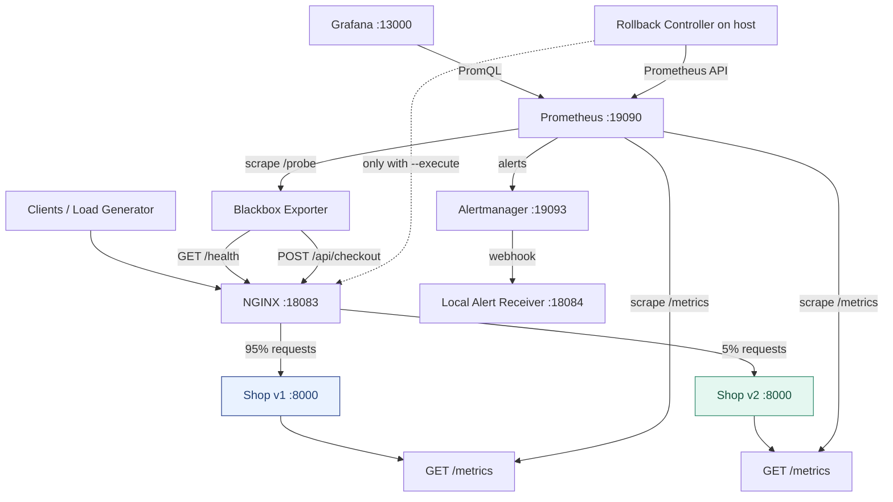
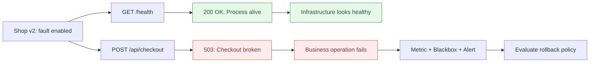
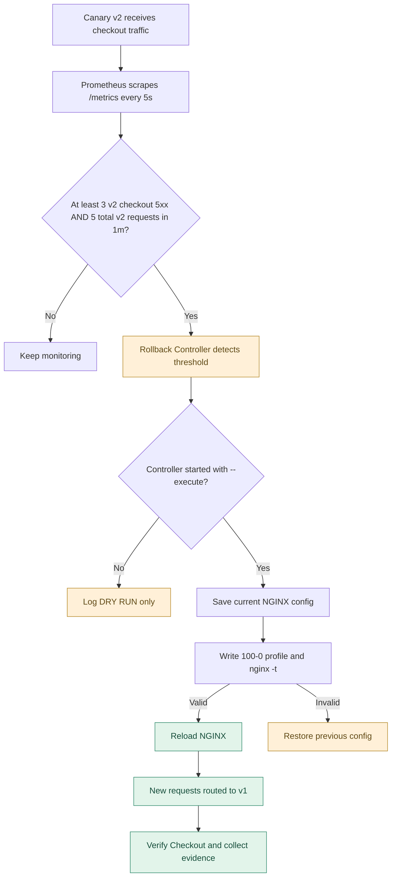
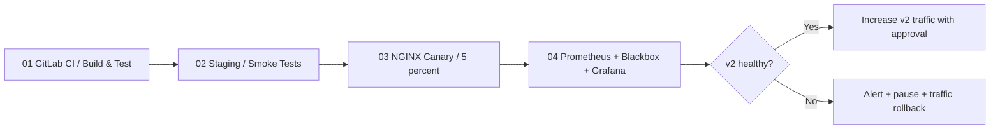

# 04 — Monitoring, Alerting & Rollback 📈

**Safe Deployment From Zero** · NetworksComputing / Sananet  
**بخش‌های پیشین:** [01 — CI/CD](../01-ci-cd/) · [02 — Staging](../02-staging/) · [03 — Canary](../03-canary/)

در سه مرحله قبل، سورس کد فروشگاه را تست کردیم، نسخه جدید را در **Staging** بررسی کردیم و در نهایت به کمک NGINX فقط بخش کوچکی از درخواست‌ها را به نسخه جدید (`v2`) فرستادیم. اما سؤال اصلی این است: **اگر v2 در حال سرویس‌دهی به کاربران واقعی خراب شود، چه چیزی متوجه می‌شود و چطور جلوی بزرگ‌تر شدن مشکل را می‌گیریم؟**

در این لابراتوار **Prometheus + Blackbox Exporter + Grafana + Alertmanager** را به همان فروشگاه متصل می‌کنیم و با یک **Rollback Controller کوچک پایتونی**، بازگرداندن ترافیک را به‌صورت کنترل‌شده تجربه می‌کنیم. تمام اجزا در Docker Compose اجرا می‌شوند؛ نیازی به Kubernetes یا سرویس Cloud نیست.

> ⚠️ **محیط آموزشی، نه Production:** «Production» در این راهنما شبیه‌سازی محلی است. هیچ تراکنش مالی واقعی، دیتابیس یا کاربر واقعی وجود ندارد. Rollback این لابراتوار **فقط مسیریابی ترافیک NGINX** را از نسخه جدید به نسخه قبلی برمی‌گرداند؛ دیتابیس، Migration، پیام‌های صف، داده یا فایل‌ها را بازیابی نمی‌کند. این پروژه را بدون سخت‌سازی امنیتی در اینترنت منتشر نکنید.

## خروجی عملی این لابراتوار

با اجرای قدم‌ها می‌توانید:

1. متریک‌های واقعی **تعداد درخواست، وضعیت HTTP و مدت پاسخ** را از `/metrics` دو نسخه اپلیکیشن بگیرید.
2. با **Blackbox Exporter** هم `GET /health` و هم **عملیات واقعی `POST /api/checkout`** را از مسیر NGINX آزمایش کنید.
3. در **Prometheus** نمودار نرخ درخواست، نرخ خطا، p95 مدت پاسخ و سلامت Probeها را Query کنید.
4. در **Grafana** یک داشبورد **از قبل Provision‌شده** ببینید؛ نیازی به Import دستی نیست.
5. با **Alertmanager** هشدار خرابی را در یک Webhook محلی ثبت کنید.
6. عمداً Checkout نسخه `v2` را خراب کنید؛ خواهید دید **`/health` همچنان 200 است ولی کاربران v2 خطای 503 می‌گیرند**.
7. با یک Controller مبتنی بر **Prometheus API** خطاهای v2 را تشخیص دهید و در حالت اجرای صریح، مسیر ترافیک را به `v1` برگردانید.

## معماری ۱ — جریان ترافیک و مشاهده‌پذیری



**مهم:** Blackbox Exporter از شبکه Docker، آدرس NGINX را بررسی می‌کند؛ این دقیقاً برابر با تست از اینترنت عمومی نیست. در محیط Production بهتر است Probe بیرونی نیز از خارج شبکه/دیتاسنتر داشته باشید.

## معماری ۲ — تفاوت Health Check با Business Check



### ابزارها و نقش دقیقشان

| ابزار | نقش | آیا خودش Rollback می‌کند؟ |
|---|---|---|
| GitLab CI/CD | Build، Test و مدیریت فرایند Deploy در مرحله اول | خیر؛ مگر Workflow انتشار مخصوص آن طراحی شود |
| Prometheus | Scrape متریک‌ها، ذخیره Time Series، اجرای Alert Rules و API | خیر |
| Blackbox Exporter | شبیه‌سازی درخواست HTTP به API و تولید `probe_success` و زمان Probe | خیر |
| Grafana | Visualization و مشاهده متریک‌ها و داشبورد | خیر |
| Alertmanager | گروه‌بندی و ارسال هشدار به Receiver | خیر |
| Rollback Controller | تصمیم درباره وضعیت v2 و تغییر وزن NGINX در حالت `--execute` | **بله؛ فقط با فعال‌سازی صریح** |

> **چرا هر دو Blackbox و اپلیکیشن متریک دارند؟** `probe_success` نشان می‌دهد یک درخواست نمونه از مسیر NGINX موفق بوده یا نه. متریک‌های `/metrics` نسخه `v2` نشان می‌دهند در مجموع چند خطای ۵xx از این نسخه دریافت شده است؛ این برای Canary پنج‌درصدی مهم است، چون یک Probe ممکن است به نسخه سالم `v1` بخورد و خطای `v2` را نبیند.

---

## ساختار فایل‌ها

```text
04-monitoring-rollback/
├── README.md                           # همین آموزش همراه با نمودار Mermaid
├── compose.yml                         # اپلیکیشن + NGINX + monitoring stack
├── .env.example                        # تنظیمات نمونه؛ .env واقعی commit نمی‌شود
├── .gitignore
├── nginx/
│   ├── active.conf                     # پروفایل فعال، پیش‌فرض 95-5
│   ├── 95-5.conf
│   ├── 80-20.conf
│   ├── 100-0.conf                       # بازگشت ترافیک به v1
│   └── 0-100.conf
├── prometheus/
│   ├── prometheus.yml                  # پنج scrape job + Alertmanager
│   └── alerts.yml                      # قوانین هشدار
├── blackbox/
│   └── blackbox.yml                    # HTTP GET health و POST checkout
├── grafana/
│   ├── provisioning/datasources/prometheus.yml
│   ├── provisioning/dashboards/default.yml
│   └── dashboards/safe-deploy.json     # داشبورد آماده
├── alertmanager/
│   └── alertmanager.yml
├── receiver/
│   ├── Dockerfile
│   └── receiver.py                      # webhook نمایش آخرین هشدارها
├── scripts/
│   ├── load_checkout.py                # بار مصنوعی روی Checkout
│   ├── traffic_control.py              # تغییر امن‌تر و قابل برگشت NGINX
│   └── rollback_controller.py          # تصمیم Rollback از Prometheus API
└── tests/
    └── test_stage4.py                  # تست متریک و منطق Controller

../demo-app/app/metrics.py                # افزوده‌شده به اپلیکیشن مشترک
../demo-app/app/server.py                 # GET /metrics + خرابی آزمایشی اختیاری
```

## پیش‌نیازها

- Docker Engine / Docker Desktop و **Docker Compose v2** (`docker compose`)
- Python 3.10+ (برای اسکریپت‌ها و Unit Test)
- حداقل حدود ۲ گیگابایت RAM آزاد (بسته به سیستم؛ عدد تقریبی)
- پورت‌های محلی آزاد: `18083`, `13000`, `19090`, `19093`, `18084`
- اینترنت فقط برای دریافت اولیه Docker Imageها؛ پس از دریافت، آزمایش محلی است.

> سرویس‌های HTTP برای کاهش ریسک فقط به `127.0.0.1` میزبان Bind شده‌اند. به Docker Socket از داخل سرویس‌ها دسترسی داده نشده است. رمز Grafana باید در فایل **نادیده‌گرفته‌شده توسط Git** یعنی `.env` تنظیم شود.

---

# آزمایش گام‌به‌گام

همه دستورهای زیر را **از پوشه `04-monitoring-rollback/`** اجرا کنید:

```bash
cd safe-deployment-from-zero/04-monitoring-rollback
```

### مرحله ۱ — مرور و تست سورس مشترک

اپلیکیشن قبلی همان سه Endpoint را دارد: `GET /health`, `GET /api/products`, `POST /api/checkout`. دو ویژگی جدید فقط برای این لابراتوار افزوده شده‌اند:

- `GET /metrics`: خروجی Prometheus Text Format، با Counter تعداد پاسخ‌های HTTP و Histogram زمان پاسخ. **برچسب‌ها محدود به method / route / status / app_version هستند**؛ مسیر یا شناسه کاربر به‌عنوان Label استفاده نمی‌شود.
- `DEMO_CHECKOUT_FAILURE=1`: فقط در `v2` و فقط روی Checkout، پاسخ 503 تولید می‌کند؛ ولی `/health` همچنان 200 می‌ماند.

```bash
cd ../demo-app
python3 -m unittest discover -s tests -v
cd ../04-monitoring-rollback
python3 -m unittest discover -s tests -v
```

**انتظار:** ۱۲ تست قبلی اپلیکیشن و تست‌های جدید این بخش موفق باشند. این تست‌ها بدون Docker هم قابل اجرا هستند.

### مرحله ۲ — رمز Grafana و راه‌اندازی Stack

```bash
cp .env.example .env
```

فایل `.env` را باز کنید و مقدار `GRAFANA_ADMIN_PASSWORD` را به یک رمز تصادفی و قوی تغییر دهید. مقدار `DEMO_CHECKOUT_FAILURE=0` را فعلاً نگه دارید.

```bash
docker compose -p safe-observe config > /dev/null   # بررسی اولیه Compose و Environment
docker compose -p safe-observe up -d --build
docker compose -p safe-observe ps
```

> هر دو نسخه اپلیکیشن از سورس **یکسان** ساخته شده‌اند تا تمرکز این درس بر Monitoring باشد؛ تفاوت نسخه‌ها در Environment Variableهاست. در محیط واقعی نسخه‌های v1 و v2 باید Imageهای نسخه‌بندی‌شده، غیرقابل تغییر و تست‌شده باشند.

### مرحله ۳ — تست API و بررسی مسیر ترافیک

```bash
curl -s http://127.0.0.1:18083/health
curl -s http://127.0.0.1:18083/api/products

curl -s -X POST http://127.0.0.1:18083/api/checkout \
  -H 'Content-Type: application/json' \
  -d '{"items":[{"sku":"keyboard","quantity":2}]}'
```

پاسخ Checkout باید `total_cents: 9599` داشته باشد؛ این همان منطق تست‌شده در بخش CI/CD است.

```bash
# تست واقعی درخواست‌ها و ایجاد داده برای Grafana
python3 scripts/load_checkout.py --requests 400

# دیدن متریک خام از داخل شبکه کانتینری
# هیچ‌کدام از Appها مستقیماً روی Host publish نشده‌اند.
docker compose -p safe-observe exec -T app-v2 python -c \
  "import urllib.request; print(urllib.request.urlopen('http://127.0.0.1:8000/metrics').read().decode()[:2000])"
```

### مرحله ۴ — آشنایی با Prometheus و Blackbox Exporter

آدرس‌های محیط محلی:

| سرویس | لینک | کاری که باید ببینید |
|---|---|---|
| اپلیکیشن از طریق NGINX | http://127.0.0.1:18083/health | پاسخ 200 با نام نسخه |
| Prometheus | http://127.0.0.1:19090 | Status → Targets و تب Query |
| Grafana | http://127.0.0.1:13000 | پوشه Safe Deployment و داشبورد آماده |
| Alertmanager | http://127.0.0.1:19093 | فهرست هشدارهای فعال |
| Local Webhook | http://127.0.0.1:18084/events | JSON هشدارهای ارسال‌شده |

در Prometheus قسمت **Status → Targets** باید Jobهای زیر را مشاهده کنید:

- `shop-app`: گرفتن متریک از **هر دو نسخه** `app-v1:8000/metrics` و `app-v2:8000/metrics`
- `blackbox-health`: درخواست بیرونی از طریق NGINX به `/health`
- `blackbox-checkout`: درخواست `POST` آزمایشی با یک سبد خرید معتبر به `/api/checkout`
- `blackbox-exporter` و `prometheus`: مانیتورینگ سلامت خود اجزا

**نکته فنی:** Blackbox Exporter با `POST` به Checkout متریک‌های `probe_success` و `probe_duration_seconds` تولید می‌کند. در این پروژه Checkout فقط مبلغ را **محاسبه** می‌کند؛ هیچ سفارش یا پرداختی ثبت نمی‌شود. برای Checkout واقعی نباید Synthetic Probe بدون Sandbox و Idempotency، سفارش یا پرداخت واقعی ایجاد کند.

### مرحله ۵ — چند PromQL مفید

در صفحه Prometheus، هر Query را جداگانه اجرا کنید:

**سلامت endpoint از بیرون:**

```promql
probe_success{job="blackbox-health"}
```

**موفقیت عملیات Checkout با یک درخواست Synthetic:**

```promql
probe_success{job="blackbox-checkout"}
```

**درصد خطاهای Checkout برای نسخه v2 (با ترافیک کافی):**

```promql
100 * sum(rate(shop_http_requests_total{app_version="v2",route="/api/checkout",status=~"5.."}[1m]))
  / clamp_min(sum(rate(shop_http_requests_total{app_version="v2",route="/api/checkout"}[1m])), 0.001)
```

**تعداد خطاهای Checkout نسخه v2 در یک دقیقه اخیر:**

```promql
sum(increase(shop_http_requests_total{app_version="v2",route="/api/checkout",status=~"5.."}[1m]))
```

**p95 زمان پاسخ Checkout بر اساس نسخه:**

```promql
histogram_quantile(0.95,
  sum by (le,app_version) (
    rate(shop_http_request_duration_seconds_bucket{route="/api/checkout"}[2m])
  )
)
```

**بررسی Scrape هر Backend:**

```promql
up{job="shop-app"}
```

> `rate` و `increase` به چند نمونه Scrape نیاز دارند. پس از راه‌اندازی چند ثانیه صبر کنید و بار تست بفرستید؛ خالی‌بودن بعضی نمودارها بلافاصله بعد از شروع طبیعی است. همچنین `increase` روی Counter در پنجره‌های کوتاه مقدار **تقریبی/برآوردی** تولید می‌کند و ممکن است عدد اعشاری نمایش دهد.

### مرحله ۶ — مشاهده داشبورد Grafana

به `http://127.0.0.1:13000` بروید و با نام کاربری و رمز فایل `.env` وارد شوید. داشبورد زیر به شکل خودکار از فایل JSON Load شده است:

`Dashboards → Safe Deployment → Safe Deployment | Monitoring & Rollback`

پنل‌ها شامل: Health Probe، Checkout Probe، خطاهای 5xx نسخه v2، نرخ درخواست‌های Checkout به تفکیک نسخه، زمان پاسخ p95، مدت Blackbox Probe، وضعیت Fault Injection، وضعیت Scrape و تعداد هشدارهای فعال.

**از کجا داده می‌آید؟** Grafana داده‌ها را از Prometheus می‌خواند. Grafana خودش اپلیکیشن را Scrape نمی‌کند؛ این تفاوت را در گزارش‌ها و معماری واقعی فراموش نکنید.

---

# سناریوی اصلی: خراب‌شدن Checkout نسخه جدید

## مرحله ۷ — خراب‌کردن عمدی v2 بدون خراب‌شدن Health Check

در این مرحله فقط کانتینر `app-v2` را با حالت Fault Injection بازسازی می‌کنیم؛ `app-v1` سالم باقی می‌ماند:

```bash
DEMO_CHECKOUT_FAILURE=1 docker compose -p safe-observe up -d --no-deps --force-recreate app-v2
```

باید بتوانید تفاوت مهم را مشاهده کنید:

```bash
# /health در v2 همچنان 200 است:
docker compose -p safe-observe exec -T app-v2 python -c \
  "import urllib.request; print(urllib.request.urlopen('http://127.0.0.1:8000/health').read().decode())"

# ولی Checkout به‌شکل عمدی HTTP 503 می‌دهد:
# خطای HTTPError: HTTP Error 503 و exit code غیرصفر در این تست کاملاً مورد انتظار است.
docker compose -p safe-observe exec -T app-v2 python -c \
  "import json,urllib.request; r=urllib.request.Request('http://127.0.0.1:8000/api/checkout',data=json.dumps({'items':[{'sku':'keyboard','quantity':2}]}).encode(),headers={'Content-Type':'application/json'},method='POST'); print(urllib.request.urlopen(r).status)"
```

اگر پیام `HTTP Error 503: Service Unavailable` مشاهده کردید، خرابی عمدی درست فعال شده است. این آزمایش با خطای HTTP پایان می‌یابد و **به معنای خرابی خود اسکریپت آزمایشی نیست**.

نسخه سالم `v1` هنوز درخواست‌های Checkout را قبول می‌کند؛ NGINX فعلاً با وزن‌های **۹۵/۵** بخشی از درخواست‌ها را به نسخه خراب می‌فرستد. این یک سناریوی کنترل‌شده برای نشان‌دادن ضرورت Canary Monitoring است.

## مرحله ۸ — ایجاد ترافیک و بررسی هشدار

```bash
python3 scripts/load_checkout.py --requests 500 --workers 8
```

خروجی باید ترکیبی از `200` و `503` باشد؛ تعداد خطاها ممکن است تقریباً به نسبت ترافیک Canary باشد اما **دقیقاً ۵٪ تضمین نمی‌شود**.

وارد Grafana شوید و این سه چیز را ببینید:

1. متریک‌های **v2 Checkout 5xx** از صفر بالا می‌روند.
2. **Health Probe ممکن است همچنان سبز بماند**؛ چون فرایند اپلیکیشن زنده است.
3. **Checkout Probe** ممکن است گاهی موفق و گاهی ناموفق باشد؛ چون مسیر NGINX تصادفی/وزنی به v1 یا v2 می‌رود. لذا فقط به یک Probe تکیه نمی‌کنیم.

در Prometheus → **Alerts**، قانون `CanaryCheckoutErrors` با حداقل ۳ خطای برآوردی v2 در یک دقیقه می‌تواند Firing شود. Alertmanager پس از گروه‌بندی، نتیجه را به یک Webhook محلی می‌فرستد:

```bash
curl -s http://127.0.0.1:18084/events

docker compose -p safe-observe logs --tail=40 alert-webhook
```

**تفاوت مهم:** Alertmanager صرفاً **هشدار** را ارسال می‌کند. تغییر واقعی ترافیک در این پروژه به عهده Controller مستقل است و پیش‌فرض به صورت **Dry Run** کار می‌کند. صرف Firing بودن Alert باعث Rollback نمی‌شود.

## معماری ۳ — تصمیم برای Rollback



### مرحله ۹ — دیدن تصمیم Controller در حالت ایمن

بعد از تولید ترافیک و ثبت حداقل دو نمونه Prometheus، دستور زیر را اجرا کنید:

```bash
python3 scripts/rollback_controller.py
```

اگر در پنجره یک‌دقیقه‌ای تعداد کافی خطای `v2` ثبت شده باشد، پیام `CANARY UNHEALTHY` و سپس `DRY RUN` را می‌بینید؛ **هیچ تغییری روی NGINX اعمال نمی‌شود**.

### مرحله ۱۰ — اجرای واقعی Rollback با اجازه صریح

در یک ترمینال جدید این دستور را اجرا کنید تا Controller هر ۵ ثانیه وضعیت را بررسی کند:

```bash
python3 scripts/rollback_controller.py --watch 5 --execute
```

اگر پنجره خطا منقضی شده، در ترمینال دیگر دوباره ترافیک تولید کنید:

```bash
python3 scripts/load_checkout.py --requests 500 --workers 8
```

وقتی شرط مهیا باشد، Controller فایل `nginx/active.conf` را با پروفایل `100-0.conf` جایگزین محتوایی می‌کند، `nginx -t` می‌زند و سپس NGINX را **Reload** می‌کند. تمام **درخواست‌های جدید** به `v1` می‌روند. (درخواست‌های در جریان ممکن است قبلاً به v2 هدایت شده باشند.)

```bash
python3 scripts/load_checkout.py --requests 100
```

پس از Rollback انتظار داریم همه Checkoutهای جدید سالم (`200`) باشند؛ اگر خطایی باقی ماند، وضعیت `v1`، Config و Logs را بررسی کنید.

**چرا فایل را به شکل In-place می‌نویسیم؟** این فایل یک Bind Mount روی Docker است و تعویض فایل با عملیات Rename/Replace ممکن است باعث شود کانتینر همچنان Inode قبلی را ببیند. برای همین Controller محتوا را با Write تغییر می‌دهد و سپس `nginx -t` و Reload اجرا می‌کند. این روش برای تمرین محلی مناسب است و جایگزین سامانه Release Management تولیدی نیست.

### مرحله ۱۱ — بازگرداندن محیط به حالت سالم

**اول نسخه v2 را تعمیر کنید** (خاموش کردن Fault Injection و Recreate):

```bash
DEMO_CHECKOUT_FAILURE=0 docker compose -p safe-observe up -d --no-deps --force-recreate app-v2
```

سپس (و فقط پس از مطمئن‌شدن از سالم‌بودن v2) مسیر را به حالت Canary اولیه برگردانید:

```bash
python3 scripts/traffic_control.py 95-5 --execute
python3 scripts/load_checkout.py --requests 200
```

برای بررسی کل آزمایش و پاک‌سازی:

```bash
docker compose -p safe-observe ps
# صرفاً توقف و حذف کانتینرها، داده Grafana/Prometheus باقی می‌ماند:
docker compose -p safe-observe down
# اختیاری و مخرب: پاک‌کردن داده‌های محلی همین پروژه:
# docker compose -p safe-observe down -v
```

---

## تفاوت Health، Readiness، Blackbox و Monitoring

**Health Check**: آیا سرویس زنده است و پاسخ مشخصی برمی‌گرداند؟ **Readiness**: آیا Replica آماده دریافت ترافیک است؟ در Kubernetes معمولاً Probeها به تصمیم درباره ترافیک هر Pod کمک می‌کنند. **Blackbox**: از بیرون مسیر شبکه/پراکسی، یک درخواست Synthetic می‌فرستد؛ ممکن است یک خطای خاص تجاری را پیدا کند. **Monitoring**: خطاها، نرخ درخواست، زمان پاسخ و شاخص‌های سرویس را در طول زمان بررسی می‌کند.

یک `/health` با HTTP 200 هرگز تضمین نمی‌کند Checkout، پرداخت، اتصال به دیتابیس یا کل Journey کاربر سالم است. باید در کنار Probeها، **Business Metrics** و شاخص‌های تجربه کاربر را هم داشت.

## سیاست‌های هشدار در این مثال

| Alert | شرط | نکته |
|---|---|---|
| `ShopHealthProbeFailed` | Blackbox health برابر صفر به مدت ۲۰ ثانیه | خرابی مسیر عمومی نمونه |
| `ShopCheckoutProbeFailed` | Blackbox Checkout برابر صفر به مدت ۲۰ ثانیه | در Canary ۵٪، ممکن است خطای v2 به شکل پیوسته دیده نشود |
| `CanaryCheckoutErrors` | حداقل ۳ خطای ۵xx v2 در یک دقیقه | مناسب برای Demo، نه Threshold واقعی |
| `CanaryUnreachable` | عدم دسترسی Prometheus به `/metrics` v2 به مدت ۱۵ ثانیه | خطا در Scrape یا Backend |

> آستانه‌ها برای سرعت نمایش آموزشی بسیار کوتاه‌اند. برای Production باید SLO، Error Budget، زمان پایش، حداقل نمونه، Golden Signals، هشدارهای قابل اقدام و کنترل Flapping را متناسب با حجم واقعی ترافیک تنظیم کنید. در این مثال بازگردانی صرفاً بر اساس خطاهای Checkout در v2 انجام می‌شود، نه تمام سناریوهای شکست احتمالی.

## پنج نکته بسیار مهم برای Production واقعی

1. **اجازه حداقلی و Audit:** به سرویس Monitoring دسترسی Write به Production یا Docker Socket ندهید. Controller واقعی باید هویت، RBAC، سیاست Rollback، Audit Trail و محدودیت هم‌زمانی داشته باشد. این اسکریپت محلی از Docker CLI میزبان استفاده می‌کند.
2. **تازگی و صحت متریک‌ها:** اگر Prometheus در دسترس نیست، داده کافی ندارد یا Query خطا می‌دهد، Controller فعلی اقدام کورکورانه نمی‌کند. در Production باید Failure Mode این مسیر مشخص باشد.
3. **دیتابیس و State:** Rollback Traffic/Container لزوماً Migration ناسازگار، Eventهای مصرف‌شده یا داده‌های جدید را به عقب برنمی‌گرداند. از الگوهای Expand/Contract، Backup و برنامه Recovery استفاده کنید.
4. **Canary واقعی:** در این Demo هر دو نسخه از یک Image و Environment Variable متفاوت ساخته شده‌اند. در Production نسخه‌ها را با Digest یا Tag تغییرناپذیر، سازگاری Session، WebSocket، ترافیک خاص کاربران و ظرفیت بررسی کنید.
5. **داده و امنیت:** Grafana، Prometheus، Alertmanager و `/metrics` را مستقیماً در اینترنت منتشر نکنید؛ TLS، AuthN/AuthZ، شبکه داخلی، محافظت از Secrets و Retention/Backup مناسب ضروری‌اند. **Webhook داخلی این پروژه فقط برای مشاهده آموزشی است، نه PagerDuty یا اطلاع‌رسانی واقعی.**

## Troubleshooting

- **Port already allocated:** از اجرای نسخه دیگر این Stack یا سرویس‌های میزبان مطمئن شوید و در `compose.yml` فقط پورت سمت چپ Mapping را تغییر دهید؛ در صورت تغییر Prometheus، فلگ `--prometheus-url` Controller هم باید به‌روز شود.
- **Grafana نمی‌آید:** `.env` را ساخته و رمز معتبر تعریف کنید؛ `docker compose -p safe-observe logs grafana` را ببینید.
- **Dashboard خالی است:** Prometheus → Targets را ببینید؛ Query `up` را اجرا کنید و ۱ تا ۲ دقیقه بار آزمایشی ارسال کنید.
- **Blackbox Checkout نتیجه غیرمنتظره می‌دهد:** فرم JSON در `blackbox/blackbox.yml` و خط `total_cents` در پاسخ اپلیکیشن را چک کنید. وضعیت موفقیت یک Probe به معنی سلامت همه ترافیک نیست.
- **Alertmanager هشدار نمی‌فرستد:** ابتدا Prometheus → Alerts باید Firing نشان دهد؛ سپس `logs alertmanager alert-webhook` را بررسی کنید. هشدارها به دلیل گروه‌بندی بلافاصله پس از اولین خطا ارسال نمی‌شوند.
- **Rollback رخ نداد:** Controller پیش‌فرض Dry Run است؛ فقط `--execute` ترافیک را تغییر می‌دهد. با `python3 scripts/rollback_controller.py` اعداد پنجره اخیر را ببینید، سپس Load بیشتری بفرستید. اگر قبلاً روی `100-0` هستید، تغییر مجدد انجام نمی‌شود.
- **Docker Desktop:** اگر Network یا Image Download به اینترنت وابسته است، ابتدا Docker Engine / DNS / Registry را بررسی کنید.
- **NGINX syntax error:** Controller تلاش می‌کند محتوای فایل قبلی را برگرداند؛ برای بررسی دستی `docker compose -p safe-observe exec -T nginx nginx -t` را اجرا کنید.

## منابع رسمی برای ادامه یادگیری

- [Prometheus — Instrumentation Best Practices](https://prometheus.io/docs/practices/instrumentation/)
- [Prometheus — Multi-target Exporter / Blackbox](https://prometheus.io/docs/guides/multi-target-exporter/)
- [Blackbox Exporter — Configuration](https://github.com/prometheus/blackbox_exporter/blob/master/CONFIGURATION.md)
- [Prometheus — Alerting Rules](https://prometheus.io/docs/prometheus/latest/configuration/alerting_rules/)
- [Alertmanager — Configuration](https://prometheus.io/docs/alerting/latest/configuration/)
- [Grafana — Provisioning](https://grafana.com/docs/grafana/latest/administration/provisioning/)

---

### جمع‌بندی چهار مرحله Safe Deployment



**هدف نهایی:** توانایی انتشار نسخه جدید فقط با `docker run` یا `kubectl apply` تعریف نمی‌شود. باید بتوانیم **قبل از انتشار تست کنیم، تدریجی منتشر کنیم، متوجه خرابی بشویم و با برنامه مشخص به وضعیت سالم برگردیم**.
